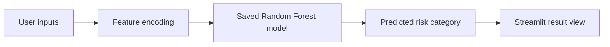

# Health Risk Predictor

  

A Streamlit application that loads a saved scikit-learn classifier and encoders to demonstrate a health-risk category prediction workflow. It is a learning project, not a medical product.

> **Safety notice:** Educational demonstration only. The model is not clinically validated. Do not use its output for diagnosis, treatment, or healthcare decisions.

## What the project demonstrates

- Collecting structured input in a Streamlit interface
- Encoding categorical values before model inference
- Loading a saved Random Forest model and label encoders
- Presenting a predicted category with simple visual context

## Prediction flow



The checked-in application loads serialized artifacts at runtime; it does not train a model when the app starts. The notebook documents data exploration and training experiments.

## Repository contents

| File | Purpose |
| --- | --- |
| `app.py` | Streamlit interface and prediction flow |
| `Health_RiskPredictor.ipynb` | Data exploration and model training experiments |
| `Health_RiskPredictor.pkl` | Serialized classifier |
| `label_encoder.pkl` | Serialized encoders |

## Run locally

Use Python 3. Create and activate a virtual environment, then install the app's direct dependencies.

```bash
git clone https://github.com/Sameer-ship-it/HEALTH_RISK_PREDICTOR.git
cd HEALTH_RISK_PREDICTOR
python -m venv .venv
```

Activate the environment:

```powershell
.venv\Scripts\Activate.ps1
```

On macOS or Linux, use:

```bash
source .venv/bin/activate
```

Then install and run:

```bash
python -m pip install streamlit pandas numpy scikit-learn matplotlib plotly
streamlit run app.py
```

Open the local URL printed by Streamlit.

## Data, artifacts, and limitations

- The notebook uses a synthetic health dataset; a separate training CSV is not included.
- Notebook metrics are experimental and do not establish clinical performance. Any future evaluation should use a documented, representative holdout dataset and appropriate review.
- Python pickle files can execute code when loaded. Load only artifacts you trust; do not replace them with untrusted files.
- This project is not suitable for real patient information or deployment in a clinical setting.

## License

No license file is currently included. Contact the repository owner before reusing or redistributing this project.
